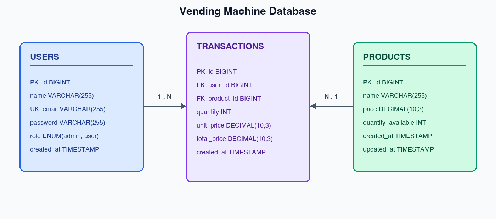

# Vending Machine - Pure PHP

A Pure PHP and MySQL vending-machine application with server-rendered Bootstrap views, role-based access, inventory-safe purchases, transaction history, a REST API, and JWT authentication.

## Requirements

- PHP 8.4 or newer with PDO MySQL
- MySQL 8 or newer
- Composer

## Setup

```bash
composer install
cp .env.example .env
```

Update `.env` with the local MySQL credentials and replace `JWT_SECRET` with a random value containing at least 32 characters.

Create the database and tables:

```bash
mysql -u root -p -e "CREATE DATABASE vending_machine CHARACTER SET utf8mb4 COLLATE utf8mb4_unicode_ci"
mysql -u root -p vending_machine < database/schema.sql
php database/seed.php
```

Start the application:

```bash
php -S localhost:8000 -t public
```

Open `http://localhost:8000/login`.

Seeded local accounts:

| Role | Email | Password |
|---|---|---|
| Admin | `admin@admin.com` | `Admin@123` |
| User | `user@user.com` | `User@123` |

Change these passwords before deploying publicly.

## Database Design



[Open the editable Excalidraw diagram](docs/vending-machine-database.excalidraw)

The schema contains these relationships:

```text
users (1) ───────< transactions >─────── (1) products
```

- `transactions.user_id` references `users.id`.
- `transactions.product_id` references `products.id`.
- One user can have many transactions.
- One product can appear in many transactions.

## Web Features

- Session authentication with hashed passwords
- Admin and user role authorization
- Admin product create, read, update, and delete
- Product pagination and sorting
- Atomic purchase flow with stock locking and transaction logging
- User-specific and admin-wide transaction history
- Server-side and client-side validation
- Attribute routes for purchase actions

## REST API

First obtain a token:

```bash
curl -X POST http://localhost:8000/api/login \
  -H 'Content-Type: application/json' \
  -d '{"email":"admin@admin.com","password":"Admin@123"}'
```

Send the returned token as `Authorization: Bearer TOKEN`.

| Method | Endpoint | Access | Purpose |
|---|---|---|---|
| POST | `/api/login` | Public | Obtain JWT |
| GET | `/api/products` | Authenticated | List products |
| GET | `/api/products/{id}` | Authenticated | View a product |
| POST | `/api/products` | Admin | Create a product |
| PUT | `/api/products/{id}` | Admin | Update a product |
| DELETE | `/api/products/{id}` | Admin | Delete a product |
| POST | `/api/products/{id}/purchase` | Authenticated | Purchase a product |

Example authenticated request:

```bash
curl http://localhost:8000/api/products \
  -H 'Authorization: Bearer TOKEN'
```

## Tests

The integration and feature suites use the separate `vending_machine_test` database configured in `.env.testing`.

```bash
composer test
vendor/bin/phpunit --testsuite Unit
vendor/bin/phpunit --testsuite Integration
vendor/bin/phpunit --testsuite Feature
```

## Project Structure

```text
app/          Controllers, services, repositories, middleware and routing core
config/       Database configuration
database/     SQL schema and seeders
public/       HTTP entry point and browser assets
routes/       Web, admin, user and API routes
tests/        Unit, integration and feature tests
views/        Admin, authentication and user templates
```

## Requirement Coverage

All 17 implementation tasks in the supplied brief are represented, including PDO persistence, authentication, role access, product CRUD, purchases, pagination, sorting, validation, PHPUnit tests, dependency injection, REST endpoints, and JWT authentication.

The remaining submission action is deployment to a server and sharing its preview URL and source code.
